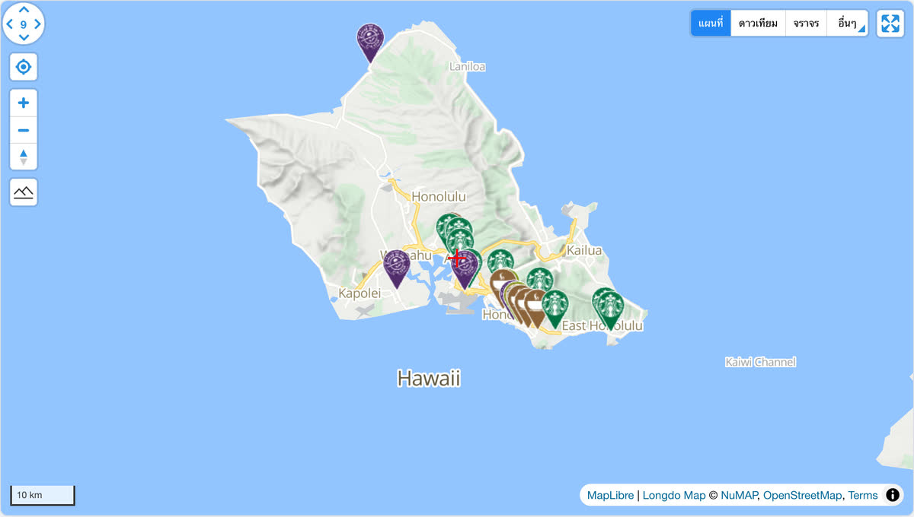

# @mapconductor/react-for-longdo

Longdo Map provider for the MapConductor React SDK. Renders a
[Longdo Map](https://map.longdo.com/) (Longdo Map API3, which uses MapLibre GL JS
internally) through MapConductor's provider-independent camera, marker, and
overlay API, so the same application code can also run on Google Maps, MapLibre,
Mapbox, MapTiler, Leaflet, OpenLayers, ArcGIS, Cesium, HERE, or TomTom.

## Demo

[](https://demo-react.mapconductor.com/longdo/map/en)

Open it in the [live demo](https://demo-react.mapconductor.com/longdo/map/en): the same store map runs on every provider, and the page switches between them. The code, cut down to three stores:

```tsx
import { useMemo, useState } from 'react';
import {
  createGeoPoint,
  createMapCameraPosition,
  createMarkerState,
  type MarkerState,
} from '@mapconductor/js-sdk-core';
import { InfoBubble, Markers } from '@mapconductor/js-sdk-react';
import { LongdoDesign, LongdoMapView2D, useLongdoViewState } from '@mapconductor/react-for-longdo';

const STORES = [
  { id: 'waikiki', name: 'Waikiki', latitude: 21.2793, longitude: -157.8292 },
  { id: 'kailua', name: 'Kailua', latitude: 21.3972, longitude: -157.7394 },
  { id: 'haleiwa', name: 'Haleiwa', latitude: 21.5928, longitude: -158.1034 },
];

const INITIAL_CAMERA = createMapCameraPosition({
  position: createGeoPoint({ latitude: 21.38, longitude: -157.93 }),
  zoom: 10,
});

export default function App() {
  const mapViewState = useLongdoViewState({
    apiKey: 'YOUR_LONGDO_API_KEY',
    mapDesignType: LongdoDesign.Normal,
    cameraPosition: INITIAL_CAMERA,
  });
  const [selected, setSelected] = useState<MarkerState | null>(null);
  const markers = useMemo(
    () =>
      STORES.map(store =>
        createMarkerState({
          id: store.id,
          position: createGeoPoint({ latitude: store.latitude, longitude: store.longitude }),
          extra: store,
          onClick: marker => setSelected(marker),
        }),
      ),
    [],
  );

  return (
    <div style={{ width: '100%', height: '100vh' }}>
      <LongdoMapView2D state={mapViewState} onMapClick={() => setSelected(null)}>
        <Markers states={markers} />
        {selected && (
          <InfoBubble marker={selected}>
            <strong>{(selected.extra as (typeof STORES)[number]).name}</strong>
          </InfoBubble>
        )}
      </LongdoMapView2D>
    </div>
  );
}
```

Replace `YOUR_LONGDO_API_KEY` with your own key.

## Installation

```shell
npm install @mapconductor/react-for-longdo @mapconductor/js-sdk-core @mapconductor/js-sdk-react
```

The Longdo Map API3 script (which bundles MapLibre GL JS and its Web Worker) is
loaded from `api.longdo.com` on demand — you do **not** need to install or
configure `maplibre-gl` yourself, and there is no stylesheet to import.

## API key

Longdo Map requires a [Longdo Map API key](https://map.longdo.com/console/) that
is authorized for the **web origin** your app is served from (unlike the Android
key, which is restricted by package name). Pass it to the view state:

```tsx
const state = useLongdoViewState({
  apiKey: LONGDO,
  mapDesignType: LongdoDesign.Normal,
  cameraPosition,
});
```

## Usage

```tsx
import {
  LongdoDesign,
  LongdoMapView2D,
  useLongdoViewState,
} from '@mapconductor/react-for-longdo';
import { MapCameraPosition, createGeoPoint } from '@mapconductor/js-sdk-core';

// Your own key. Read it from your environment however your build tool does
// it, and keep it out of source control.
const LONGDO = '…';

function Map() {
  const state = useLongdoViewState({
    apiKey: LONGDO,
    mapDesignType: LongdoDesign.Normal,
    cameraPosition: MapCameraPosition.create({
      position: createGeoPoint({ latitude: 13.7563, longitude: 100.5018 }),
      zoom: 11,
    }),
  });

  return <LongdoMapView2D state={state} />;
}
```

## Map designs

`LongdoDesign` exposes the standard base layers provided by `longdo.Layers`:

`Normal`, `Easy`, `Pastel`, `PastelGray`, `Hard`, `Gray`, `Light`, `Night`,
`Dark`, `Political`, `Osm`, `Satellite` (`SPHERE_IMAGES`), `Hybrid`
(`SPHERE_HYBRID`).

Switch design by updating the view state's `mapDesignType`.

## How it works

Longdo Map API3 renders through an internal MapLibre GL JS map exposed as
`map.Renderer`. This provider bootstraps the base map, camera, and base-layer
designs through the Longdo wrapper (`longdo.Map`) and drives camera control,
map events, and all overlays (markers, polylines, polygons, circles, ground
images, raster layers) through `map.Renderer` — the same MapLibre-based renderer
architecture used by the other MapConductor MapLibre-family providers.

## License

Apache-2.0
